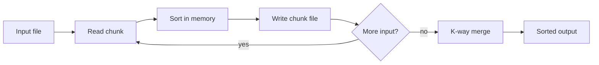

# Large File Sort

Two .NET 10 console applications:

- **GeneratorApp** creates a test file of a given size with lines in the format `Number. String`.
- **SortApp** sorts such a file by String, then by Number, using an external merge sort. It is designed for files far larger than memory (~100 GB).

```
Input                                   Output
415. Apple                              1. Apple
30432. Something something something    415. Apple
1. Apple                                2. Banana is yellow
32. Cherry is the best                  32. Cherry is the best
2. Banana is yellow                     30432. Something something something
```

## Requirements

- .NET 10 SDK
- Free disk space of about twice the input size (temporary chunk files plus the output)

## Build and test

```bash
dotnet build -c Release
dotnet test
```

## Usage

Run from the repository root. Relative paths for input, output and temporary files resolve against the current folder.

**1. Generate a test file**

```bash
dotnet run -c Release --project GeneratorApp -- 1GB
```

The size accepts bytes or `KB`, `MB`, `GB` (1 GB = 1024³ bytes). Without an argument, the app asks for the size. The file is written to `./Output/Lines.txt`.

**2. Sort it**

```bash
dotnet run -c Release --project SortApp -- ./Output/Lines.txt
```

The sorted file is written to `./Output/SortedLines.txt`. The app prints the input size and the time of each phase.

Both apps return exit code 0 on success and 1 on error, with the error message on `stderr`.

## Configuration

Each app reads `appsettings.json` from its output folder. Values are validated at startup.

**GeneratorApp** (section `GeneratorApp`)

| Key | Default | Meaning |
| --- | --- | --- |
| `MaxNumber` | 1000 | Numbers are drawn from 0 up to, but not including, this value |
| `SeedPhraseFilePath` | `./Resources/SeedPhrases.txt` | Phrases used for the String part, relative to the app folder |
| `DuplicateRate` | 5 | Chance, in percent, that a line repeats the previous line's phrase (0–100) |
| `OutputFileBufferSize` | 1048576 | Write buffer, bytes |
| `OutputFilePath` | `./Output/Lines.txt` | Generated file |

**SortApp** (section `SortApp`)

| Key | Default | Meaning |
| --- | --- | --- |
| `ChunkSizeMb` | 256 | Input processed in memory per sorted chunk |
| `ChunkListCapacity` | 12000000 | Pre-allocated lines per chunk (avoids list resizing) |
| `TempDirOutputPath` | `./Temp` | Folder for chunk files. **Must be dedicated to the app: it is deleted at start and at exit** |
| `OutputFileBufferSize` | 1048576 | Read and write buffer, bytes |
| `OutputFilePath` | `./Output/SortedLines.txt` | Sorted file |

## How it works

**Generator.** Lines are built from a random number and a phrase from a list of 372 simple phrases. Phrases repeat across the file, and `DuplicateRate` controls how often consecutive lines share a phrase, so the output always contains lines with the same String part. Lines are written through one large buffer without per-line allocations.

**Sorter.** An external merge sort in two phases:

1. **Split.** Read the input sequentially, parse lines into `Line(long Number, string Text)` until a chunk reaches `ChunkSizeMb`, sort the chunk in memory and write it to a temporary file. Memory use depends on the chunk size, not on the file size.
2. **Merge.** Open all chunk files and merge them with a `PriorityQueue`, which always yields the smallest current line among the chunks. Each chunk is read once and the output is written once.



## Design decisions

- **Ordinal, case-sensitive comparison.** Strings are compared by character code. This is fast and independent of the machine's culture. As a consequence, all uppercase letters sort before lowercase ones: `Apple` < `Zebra` < `apple`.
- **Numbers** are non-negative and fit in `long`.
- **Malformed lines are errors.** A line without `". "` or with an invalid number stops the sort with a message that shows the line; nothing is skipped silently.
- **Line endings.** The generator writes `\n`; the sorter accepts `\n` and `\r\n`. A missing line break at the end of the file is fine.
- **Safe paths.** The sorter refuses to run when the output file is the input file, or when either is inside the temp folder, because the temp folder is deleted. The check runs before anything is written.
- **One line format.** `Line`, `Line.Parse` and `LineWriter` in the shared `Core` project define the format for both apps.

## Project structure

| Project | Contents |
| --- | --- |
| `Core` | `Line`, `LineWriter`, options loading and validation, path helpers |
| `GeneratorApp` | Test file generator, file size parsing |
| `SortApp` | External merge sort (`ChunkSplitter`, `FileMerger`), `LineComparer`, path checks, temp folder handling |
| `Tests` | xUnit unit tests and end-to-end sorter tests |

## Performance

Test machine: MacBook Pro (MacBookPro18,3), Apple M1 Pro, 10 cores (8 performance + 2 efficiency), 32 GB RAM, 1 TB Apple SSD (AP1024R), macOS 26.6.2, .NET SDK 10.0.401.

Release build, default `appsettings.json` (`ChunkSizeMb: 256`, 1 MB buffers). Peak memory is the maximum resident set size.

**Generator:**

| File | Lines | Time | Peak memory |
| --- | --- | --- | --- |
| 1 GB | 41,191,292 | 1.6 s | 57 MB |
| 10 GB | 411,914,371 | 13.3 s | 57 MB |
| 100 GB | 4,119,106,688 | 2 min 11 s | 57 MB |

**Sorter:**

| File | Split | Merge | Total | Peak memory |
| --- | --- | --- | --- | --- |
| 1 GB | 26.2 s | 3.7 s | 29.9 s | 1.35 GB |
| 10 GB | 4 min 17 s | 48.4 s | 5 min 5 s | 1.64 GB |
| 100 GB | 42 min 27 s | 14 min 25 s | 56 min 53 s | 1.72 GB |
